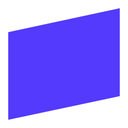

<div align="center">


</div>

<div align="center">

[](https://git.io/typing-svg)

</div>

---


### 👨‍💻 About Me

```yaml
name:       Michael Alejandro
handle:     JeAleCast7
location:   Bogotá, Colombia 🇨🇴
university: ESEIT — Software Engineering

focus:
  - Web platforms with PHP & MariaDB
  - Workflow automation with n8n
  - SOLID architecture & Docker

interests:
  - Open Source
  - Linux & Cybersecurity
  - Browser Privacy
  - AI & Local LLMs (Ollama)

outside_code:
  - Working toward a one-arm push-up 💪
```

<br clear="right"/>

---

## 🛠️ Tech Stack

### 🌐 Frontend
<p>
  
  
  
  
  
  
  
</p>

### ⚙️ Backend
<p>
  
  
  
</p>

### 🗄️ Databases
<p>
  
  
</p>

### ☁️ DevOps & Deployment
<p>
  
  
  
  
  
  
  
  
</p>

### 💡 Payments & Automation
<p>
  
  
  
  
</p>

---

## 🚀 Featured Projects

<table>
<tr>
<td width="50%" valign="top">

### 🏠 Inmobiliaria
**Real estate web platform** with role-based access for tenants, buyers, and sellers — built with a layered SOLID architecture.

<p>
   PHP &nbsp;
   MariaDB &nbsp;
   Docker
</p>

- 🗺️ Interactive maps with Leaflet.js / OpenStreetMap
- 🐳 Containerized & published to Docker Hub
- 🚂 Deployed on Railway
- 🏗️ Models · Repositories · Services pattern

[](https://github.com/JeAleCast7/inmobiliaria)

</td>
<td width="50%" valign="top">

### 🤖 English Grammar Bot
**Daily B2-level grammar exercises** delivered via Telegram & WhatsApp using LLaMA 3.3-70b through Groq's API.

<p>
   n8n &nbsp;
   Telegram &nbsp;
   WhatsApp &nbsp;
   LLaMA / Groq
</p>

- 📬 Two-workflow architecture: delivery + evaluation
- 🧠 LLM-powered question generation & grading
- ⏰ Scheduled daily triggers
- ✅ Automatic answer feedback

</td>
</tr>
</table>

---

## 📊 GitHub Stats

<div align="center">


&nbsp;


</div>

<div align="center">


</div>

---

## 📫 Let's Connect

<div align="center">

[](https://github.com/JeAleCast7)

</div>

---

<div align="center">


</div>
