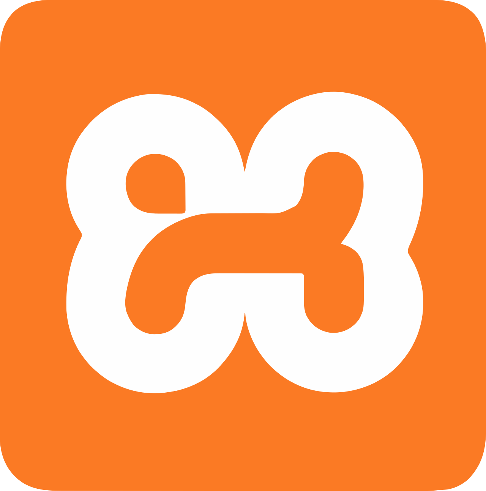

<div align="center">


</div>

<div align="center">

[](https://git.io/typing-svg)

</div>

---


<table align="center">
<tr>
<td width="50%" valign="top">

<h3 align="center">About this guy</h3>


```yaml
name:       Jesus Alejandro
handle:     JeAleCast7
location:   Bogotá, Colombia
university: ESEIT — Computer Engineering

focus:
  - Web platforms with PHP & MariaDB
  - Workflow automation with n8n
  - SOLID/MCV architecture & Docker

interests:
  - Backend
  - Cybersecurity (Purple Team)
  - Browser Privacy
  - AI & Local LLMs (Ollama)

outside_code:
  - Looking for C1 English Level (currently B2+)
  - Musical Production with Reaper
  - Guitar covers in Youtube (Jcastero)
```

</td>
<td width="50%" valign="top" align="center">

## Stack

### Frontend
<p align="center">
  
  
  
  
  
  
  
</p>

### Backend & Databases
<p>
  
  
  
  
  
</p>
</div>

### Tools & Deployment
<p>
  
  
  
  
  
  
  
  
  
</p>

### Payments & Automation
<p>
  
  
  
  
</p>

</td>
</tr>
</table>

---

<h1 align="center">Featured Projects</h1>
<div align="center">

</div>

<table>
<tr>
<td width="50%" valign="top">

### Inmobiliaria
**Real estate web platform** with role-based access for tenants, buyers, and sellers — built with a layered SOLID architecture.

<p>
   PHP &nbsp;
   MariaDB &nbsp;
   Docker
</p>

- 🗺️ Interactive maps with Leaflet.js / OpenStreetMap
- 🐳 Containerized & published to Docker Hub
- 🚂 Deployed on Railway
- 🏗️ Models · Repositories · Services pattern

[](https://github.com/JeAleCast7/inmobiliaria)

</td>
<td width="50%" valign="top">

### English Grammar Bot
**Daily B2-level grammar exercises** delivered via Telegram & WhatsApp using LLaMA 3.3-70b through Groq's API.

<p>
   n8n &nbsp;
   Telegram &nbsp;
   WhatsApp &nbsp;
   Ollama / Groq
</p>

- 📬 Two-workflow architecture: delivery + evaluation
- 🧠 LLM-powered question generation & grading
- ⏰ Scheduled daily triggers
- ✅ Automatic answer feedback

</td>
</tr>
</table>

---

## GitHub Stats

<div align="center"></div>

<div align="center">

<a href="https://awesome-github-stats.azurewebsites.net/index.html??cardType=github&theme=ocean-dark&fontFamily=VT323&preferLogin=false">    
  
</a>

</div>

---

## Let's Connect

<div align="center">

[](https://github.com/JeAleCast7)

</div>

<div align="center">

[](https://www.instagram.com/jcast_tero)

</div>

---

<div align="center">


</div>
