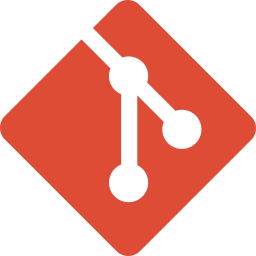

<div align="center">

# Hola, soy Jesus

### Desarrollador Web & Estudiante de Ingeniería de Software

*Construyendo soluciones con código limpio, arquitecturas sólidas y mucha curiosidad.*

[](https://github.com/JeAleCast7)
[](https://maps.app.goo.gl/bogota)

</div>

---

## 🧑‍💻 Sobre mí

```text
🎓  Estudiante de Ingeniería de Software @ ESEIT
🔭  Actualmente construyendo plataformas web con PHP + MariaDB y apps de escritorio con Python
🌱  Aprendiendo arquitecturas SOLID, Docker y automatización con n8n
⚡  Me interesa el open source, Linux, la ciberseguridad y el rendimiento web
🏋️  Fuera del código: entrenando hacia el push-up a un brazo
```

---

## 🛠️ Stack Tecnológico

### Frontend
<p>
  
  
  
  
  
  
</p>

### Backend
<p>
  
  
  
</p>

### Bases de datos
<p>
  
  
</p>

### DevOps & Herramientas
<p>
  
  
  
  
  
  
</p>

---

## 🚀 Proyectos Destacados

### 🏠 [Inmobiliaria](https://github.com/JeAleCast7/inmobiliaria)
> Plataforma web de gestión inmobiliaria con roles diferenciados para arrendatarios, compradores y vendedores.

- **Stack:** PHP · MariaDB · Apache · Leaflet.js / OpenStreetMap
- **Arquitectura:** Principios SOLID con separación en modelos, repositorios y servicios
- **Infra:** Dockerizado y publicado en Docker Hub (`jealecast7/inmobiliaria`)
- **Despliegue:** Railway

---

### 🏢 [Conjunto Multifamiliar](https://github.com/JeAleCast7)
> App de escritorio para administración de conjuntos residenciales con módulos por rol.

- **Stack:** Python · Tkinter · SQLite
- **Módulos:** Administración · Contabilidad · Revisión fiscal · Usuarios

---

### 🤖 Bot de Inglés con n8n + Telegram
> Automatización que envía ejercicios de gramática nivel B2 diariamente vía Telegram usando LLaMA 3.3-70b (Groq).

- **Stack:** n8n · Telegram Bot API · Groq API
- **Arquitectura:** Dos flujos — entrega de preguntas y evaluación de respuestas

---

## 📊 Estadísticas de GitHub

<div align="center">


</div>

---

## 📫 Contacto

<div align="center">

¿Tienes un proyecto en mente o quieres colaborar?

[](https://github.com/JeAleCast7)

</div>

---

<div align="center">

*"El buen código es su propia mejor documentación."* — Steve McConnell

</div>
